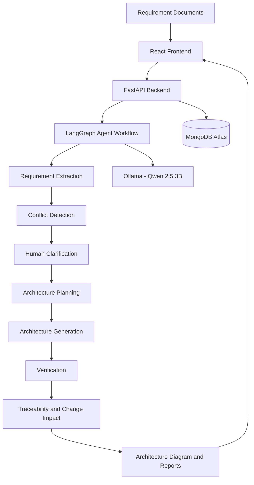

# 🧠 ArchIntel AI
### AI Software Architect – Requirements-to-Architecture Agent

**Transforming natural-language software requirements into intelligent, traceable and adaptable software architecture.**

[](https://www.python.org/)
[](https://react.dev/)
[](https://fastapi.tiangolo.com/)
[](https://www.langchain.com/langgraph)
[](https://ollama.com/)
[](https://www.mongodb.com/)

---

## 📌 Project Overview

ArchIntel AI is an AI-powered software architecture assistant designed to bridge the gap between software requirements and architecture design.

Traditional architecture design requires significant manual effort to understand requirements, identify ambiguities, resolve conflicting information and create architecture diagrams.

ArchIntel AI automates this process using a local Large Language Model (LLM), an agent-based workflow and human-in-the-loop decision-making.

It transforms unstructured software requirements into structured requirements, architecture recommendations, verification results and change impact insights.

## 🎯 Problem Statement

Software requirements are often incomplete, ambiguous or conflicting.

Traditional architecture design faces challenges such as:

- Manual requirement analysis.
- Difficulty identifying missing information.
- Conflicting stakeholder requirements.
- Time-consuming architecture design.
- Limited requirement traceability.
- Difficulty adapting architecture when requirements change.

**Our solution:** An intelligent agentic system that analyzes, plans, generates, verifies and adapts software architecture with human supervision.

## ✨ Key Features

### 1. Automated Requirement Extraction
- Upload software requirement documents.
- Extract functional requirements.
- Extract non-functional requirements.
- Organize requirements into structured information.

### 2. Ambiguity and Conflict Detection
- Identify unclear requirements.
- Detect potential contradictions.
- Identify missing architectural constraints.
- Generate stakeholder clarification questions.

### 3. Human-in-the-Loop Interaction
- Present clarification questions as multiple-choice questions.
- Provide relevant options for each question.
- Allow stakeholders to select **Other** and enter custom answers.
- Use approved decisions during architecture generation.

### 4. Intelligent Architecture Generation
- Recommend architecture styles.
- Identify components and services.
- Generate component relationships.
- Represent architecture using Mermaid diagrams.
- Document architectural assumptions and decisions.

### 5. Architecture Verification
- Check requirement coverage.
- Map requirements to architecture components.
- Identify potential design gaps.
- Provide verification results.

### 6. Change Impact Analysis
- Accept modified requirements.
- Identify affected architecture components.
- Update architecture recommendations.
- Provide change impact information.

## 🏗️ System Architecture



## 🔄 Workflow

1. **Input:** Upload a software requirements document.
2. **Analyze:** Extract functional and non-functional requirements.
3. **Detect:** Identify ambiguities, conflicts and missing information.
4. **Clarify:** Ask stakeholders questions and collect approved decisions.
5. **Plan:** Develop an architecture plan based on the requirements.
6. **Generate:** Create architecture components and relationships.
7. **Verify:** Check architecture against the extracted requirements.
8. **Adapt:** Analyze the impact of requirement changes.

## 🛠️ Technology Stack

| Layer | Technology |
|---|---|
| Frontend | React.js, CSS, Vite |
| Backend | Python, FastAPI |
| Agent Orchestration | LangGraph |
| Large Language Model | Qwen 2.5 3B |
| Local LLM Runtime | Ollama |
| Database | MongoDB Atlas |
| Architecture Visualization | Mermaid.js |
| API Communication | REST API |

## 📁 Project Structure

```text
ArchIntel_AI_TCS_Hackathon/
│
├── backend/
│   ├── app/
│   │   ├── main.py
│   │   ├── agents.py
│   │   ├── llm.py
│   │   ├── parser.py
│   │   ├── db.py
│   │   └── config.py
│   │
│   ├── requirements.txt
│   └── .env.example
│
├── frontend/
│   ├── src.jsx
│   ├── style.css
│   ├── package.json
│   └── index.html
│
├── .gitignore
└── README.md
```

*The structure above is illustrative; adjust it to match the actual repository files.*

## ⚙️ Installation and Setup

### Prerequisites

Install the following:

- Python 3.11
- Node.js and npm
- Git
- Ollama
- MongoDB Atlas account

### 1. Clone the Repository

```bash
git clone https://github.com/Selvaganapathy-k/TCS-AI-for-Tech.git

cd TCS-AI-for-Tech
```

### 2. Configure the Backend

```bash
cd backend

python -m venv .venv
```

Activate the environment on Windows:

```powershell
.venv\Scripts\activate
```

Install dependencies:

```bash
pip install -r requirements.txt
```

### 3. Configure Environment Variables

Create a `.env` file inside the backend directory.

```env
OLLAMA_BASE_URL=http://localhost:11434
OLLAMA_MODEL=qwen2.5:3b

MONGODB_URI=your_mongodb_atlas_connection_string
MONGODB_DATABASE=archintel

MAX_UPLOAD_MB=15
```

**Security:** Never upload your actual `.env` file, database password or API credentials to GitHub.

### 4. Configure Ollama

Install Ollama and download the model:

```bash
ollama pull qwen2.5:3b
```

Verify the model:

```bash
ollama list
```

Ensure the Ollama API is available at:

```text
http://localhost:11434
```

### 5. Start the Backend

From the backend directory:

```bash
uvicorn app.main:app --reload --port 8000
```

Backend API:

```text
http://127.0.0.1:8000
```

API documentation:

```text
http://127.0.0.1:8000/docs
```

### 6. Start the Frontend

Open another terminal:

```bash
cd frontend

npm install

npm run dev
```

Open the frontend at:

```text
http://localhost:5173
```

## 🧪 Example Use Case

**Scenario: E-Commerce Application Architecture**

Sample requirements:

- Support 10,000 concurrent users.
- Customers can browse products.
- Customers can add products to their carts.
- Customers can place orders.
- Customer passwords must be securely hashed.
- Sensitive customer information must be encrypted.
- Target 99.9% monthly availability.
- Product search should return results within two seconds.

ArchIntel AI analyzes these requirements, identifies missing architectural decisions, asks stakeholders for clarification and generates an architecture recommendation.

Possible architecture components include:

- ProductCatalogService
- UserSessionService
- OrderService
- PaymentService
- CustomerService
- MonitoringService

These are illustrative components for the example scenario.

## 🚀 Innovation and Impact

ArchIntel AI combines multiple capabilities into a single architecture workflow:

- **Reason:** Understand and analyze software requirements.
- **Plan:** Develop architecture plans.
- **Act:** Generate architecture artifacts.
- **Verify:** Evaluate requirement coverage and consistency.
- **Adapt:** Respond to changing requirements.
- **Human Control:** Keep stakeholders involved in important decisions.

Our goal is to make architecture design more transparent, explainable and adaptable.

## 🔮 Future Enhancements

- Advanced architecture pattern recommendations.
- Automated security and compliance assessment.
- Architecture cost estimation.
- Cloud deployment recommendations.
- Integration with GitHub and CI/CD pipelines.
- Advanced architecture quality evaluation.

## 👥 Team

**Team Name:** [Add Team Name]

**Team Members:**
1. [Member 1]
2. [Member 2]
3. [Member 3]
4. [Member 4]

## 🏆 Hackathon

**Event:** TCS AI Engineering Hackathon  
**Challenge:** Challenge 02 – AI Software Architect: Requirements-to-Architecture Agent

## 📜 License

This project is developed as part of the TCS AI Engineering Hackathon. Add an appropriate open-source license if you intend to distribute it publicly.

---

<p align="center">
  <b>ArchIntel AI</b><br/>
  Making Software Architecture Intelligent, Explainable and Adaptive.
</p>
